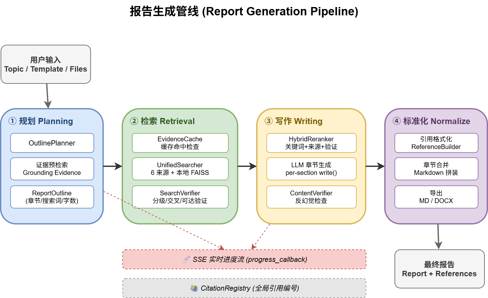
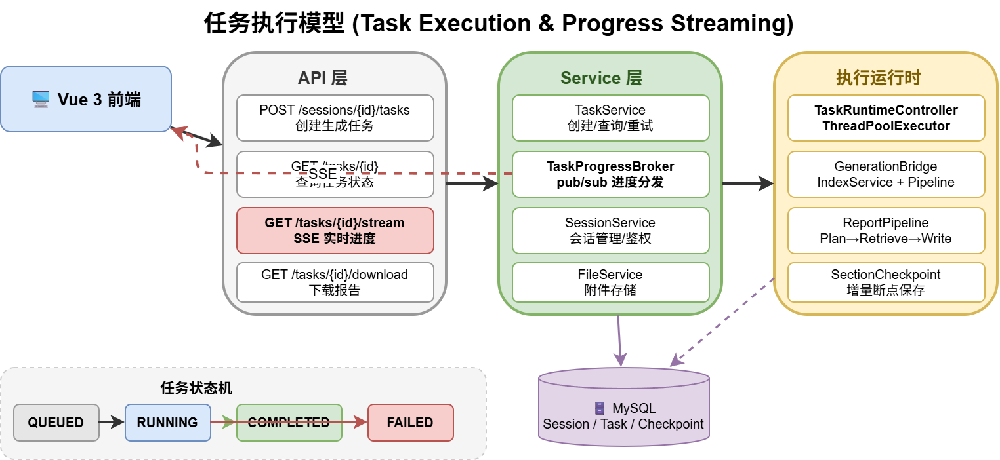
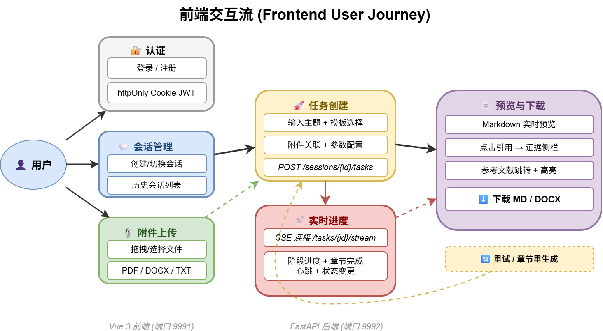

# IntelliGen 架构文档

> 版本：v2.6 | 最后更新：2026-04

## 概述

IntelliGen 是面向研究型写作与深度研究场景的智能助手，采用 **FastAPI + Vue 3** 前后端分离架构，支持多源学术检索、可信引用、本地附件 RAG、多阶段生成与实时进度流。

## 系统架构

| 层 | 技术栈 |
|---|---|
| 前端 | Vue 3 + Vite + Pinia (端口 9991) |
| 后端 | FastAPI + SQLAlchemy 2.0 + Pydantic (端口 9992) |
| 数据库 | SQLite (WAL 模式) + Alembic 迁移 |
| 检索 | 6 来源学术搜索 + FAISS 本地向量索引 |
| LLM | OpenRouter API — Qwen 系列双模型（Chat + Fast） |
| 可观测性 | structlog + request_id + audit 中间件 |

### LLM 模型架构

采用双模型分层策略，通过 `ModelRouter` 按任务类型自动路由：

| 模型层 | 默认模型 | 任务类型 | 用途 |
|---|---|---|---|
| Chat (主力) | `qwen/qwen3-235b-a22b` | planning, writing, review | 规划大纲、章节写作、质量审查 |
| Fast (轻量) | `qwen/qwen3-30b-a3b` | keyword, summary, clarify | 关键词提取、摘要生成、需求澄清 |
| Search | `perplexity/sonar-pro` | search | 实时学术搜索 |

所有模型配置统一在 `config.py` 中管理，通过 `.env` 覆盖，不硬编码。

### 需求澄清系统

在任务提交前增加了智能澄清流程：

1. **启发式检查**：先用规则判断输入是否足够详细（字数、关键词、有无大纲/模板/附件）
2. **LLM 澄清**：对模糊输入生成 3-5 个结构化问题（使用 Fast 模型）
3. **结构化输出**：用户回答后合并为 `{topic, requirements, suggestedOutline}` 传入生成管线
4. **Fail-open**：澄清 LLM 调用失败时直接进入生成，不阻断流程
5. **可跳过**：用户可随时跳过澄清，使用原始输入直接生成

## 报告生成管线

生成流程分为四个阶段，由 `ReportPipeline` 统一编排：



### 阶段说明

**① 规划 (Planning)**
- `OutlinePlanner` 根据主题和模板生成结构化大纲
- 包含预检索（Grounding Evidence），为每个章节生成搜索词和字数目标
- 输出 `ReportOutline`，包含章节层级、搜索词、预估字数

**② 检索 (Retrieval)**
- 先检查 `EvidenceCache` 是否有可复用的已验证结果
- 通过 `UnifiedAcademicSearcher` 从 6 个来源并行检索
- `SearchVerifier` 对结果做三层验证（来源分级、交叉验证、DOI 可达性）
- 已验证结果缓存到 `EvidenceCache` 供未来任务复用
- 详见 [RAG 检索管线文档](RAG_PIPELINE.md)

**③ 写作 (Writing)**
- `HybridReranker` 混合排序：关键词重叠 + 来源可信度 + 验证状态
- 每个章节独立调用 LLM 生成，支持 section 级本地检索补充
- `ContentVerifier` 做反幻觉检查：提取事实断言 → 映射证据 → 分类处理
- 编造内容的引用标记会被剥离，替换为保守表述
- **章节级错误恢复**：单章节 LLM 失败时以占位符替代，不中断全文生成；所有章节均失败时报错

**③.5 质量检查 (Quality Check)**
- `QualityChecker` 在写作完成后、标准化前运行
- **字数检查**：每节字数 ≥ 目标的 50%
- **引用检查**：每节至少包含 1 个 `[N]` 引用标记
- **重复检测**：Jaccard 相似度 > 0.8 的章节对视为近重复
- 质量结果附在报告元数据中，不阻断输出

**④ 标准化 (Normalize)**
- `ReferenceBuilder` 根据实际使用的证据生成参考文献
- `CitationValidator` 清理未使用的引用编号
- 章节合并为最终 Markdown，支持导出 DOCX

### 横切关注点

- **SSE 进度流**：`TaskProgressBroker` 在每个阶段发送实时进度事件，终态后自动 `cleanup()` 清理订阅
- **CitationRegistry**：全局引用编号注册表，确保 `[N]` 编号唯一且可追溯
- **LLM 可靠性**：
  - 重试退避：429/502-504/超时自动重试 3 次（指数退避 2s 起步）
  - Token 安全：每次调用 `max_tokens` 钳制到模型上限的 85%
  - 超时自适应：handler 超时钳制到 [60, 600]s
- **错误分类**：`classify_generation_error()` 将异常映射到 5 类 errorCategory，前端据此展示恢复指导

## 任务执行模型

任务从创建到完成的完整生命周期：



### 关键组件

| 组件 | 职责 |
|---|---|
| TaskService | 任务创建、状态管理、鉴权 |
| TaskProgressBroker | pub/sub 进度分发，支持 SSE 推送 |
| TaskRuntimeController | 线程池执行器，控制并发数 |
| GenerationBridge | 连接任务层与生成管线，管理 IndexService |
| SectionCheckpoint | 增量断点保存，支持断点续跑 |

### 任务状态机

```
QUEUED → RUNNING → COMPLETED
                 → FAILED
       → CANCELLED (用户主动取消)
FAILED → RETRYING → QUEUED (重试)
CANCELLED → RETRYING → QUEUED (重试)
```

### API 端点

| 方法 | 路径 | 说明 |
|---|---|---|
| POST | `/sessions/{id}/tasks` | 创建生成任务 |
| GET | `/tasks/{id}` | 查询任务状态 |
| GET | `/tasks/{id}/stream` | SSE 实时进度 |
| GET | `/tasks/{id}/download` | 下载报告 (MD/DOCX) |
| POST | `/tasks/{id}/cancel` | 取消运行中的任务 |

## 前端交互流



### 用户流程

1. **认证** — 登录/注册，httpOnly Cookie 携带 JWT
2. **会话管理** — 创建或切换会话，查看历史
3. **附件上传** — 拖拽上传 PDF/DOCX/TXT 文件
4. **任务创建** — 输入主题、选择模板、关联附件
5. **需求澄清** — 模糊输入触发 LLM 提问，loading overlay + Ctrl+Enter 提交 / Esc 跳过
6. **实时进度** — SSE 连接推送阶段进度和章节完成事件
7. **预览下载** — Markdown 实时预览、引用侧栏、参考文献跳转、下载 MD/DOCX
8. **取消任务** — 运行中的任务可一键取消，前端展示取消按钮
9. **重试** — 支持整体重试或单章节重生成
10. **错误恢复** — 失败任务展示分类恢复建议（额度/安全/引擎/RAG 等）

## 项目结构

```
IntelliGen/
├── apps/
│   ├── backend/
│   │   ├── alembic/              # 数据库迁移
│   │   ├── app/
│   │   │   ├── api/              # 路由入口
│   │   │   ├── platform/         # config, db, logging, security
│   │   │   └── modules/
│   │   │       ├── auth/         # 认证与用户
│   │   │       ├── admin/        # 管理功能
│   │   │       ├── workspace/    # 会话、任务、文件
│   │   │       └── generation/   # 生成核心
│   │   │           ├── planning/     # 大纲规划
│   │   │           ├── retrieval/    # RAG 检索链路
│   │   │           ├── writing/      # 写作与验证
│   │   │           ├── review/       # Rubric 审核
│   │   │           ├── regeneration/ # 重生成桥接
│   │   │           ├── export/       # 导出
│   │   │           └── shared/       # 共享工具
│   │   └── tests/
│   └── frontend/
│       └── src/
│           ├── app/              # 路由、布局
│           ├── features/         # auth, workspace, admin
│           ├── shared/           # 通用组件、API helpers
│           └── assets/
├── docs/
│   ├── current/                  # 当前版本文档
│   └── archive/                  # 历史文档
└── legacy/                       # 归档旧服务
```

## 相关文档

- [RAG 检索管线](RAG_PIPELINE.md) — 证据检索、验证、缓存与反幻觉机制
- [API 文档](API文档.md) — 接口规范
- [数据库设计](数据库设计文档.md) — 数据模型
- [前后端交互](前后端交互说明文档.md) — 交互协议
