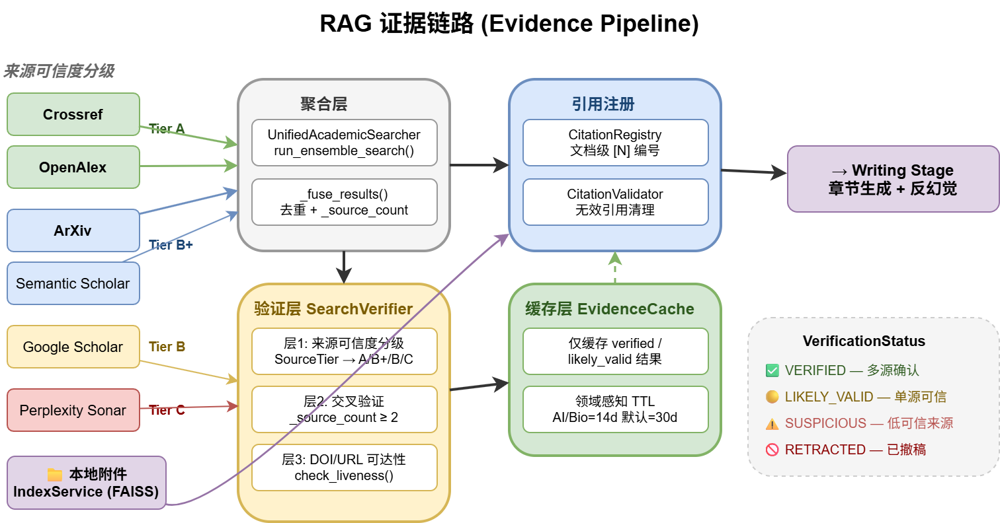
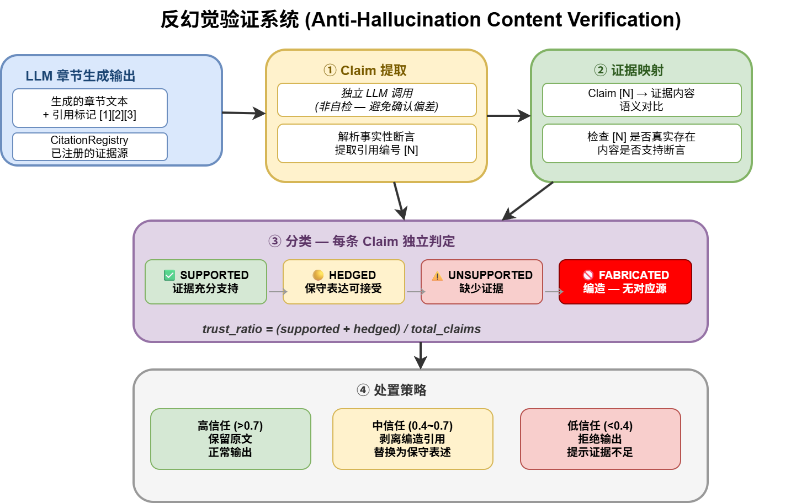
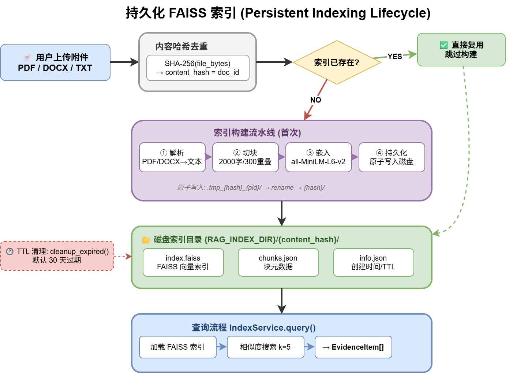

# RAG 检索管线

> 版本：v2.4 | 最后更新：2026-04

## 概述

IntelliGen 的 RAG（检索增强生成）管线负责为报告的每个章节提供经过验证的证据支持。管线覆盖从多源检索到反幻觉验证的完整链路，确保生成内容有据可查。

## 证据检索链路



### 检索来源与可信度分级

管线从 6 个来源并行检索，每个来源有预设的可信度等级：

| 来源 | Tier | 说明 |
|---|---|---|
| Crossref | A | 学术元数据权威来源，DOI 注册机构 |
| OpenAlex | A | 开放学术图谱，覆盖 2.5 亿+论文 |
| ArXiv | B+ | 预印本服务器，未经同行评审 |
| Semantic Scholar | B+ | AI2 学术搜索引擎 |
| Google Scholar | B | 广覆盖但结构化程度低 |
| Perplexity Sonar | C | LLM-based 搜索，可能返回编造内容 |

### 检索流程

1. **缓存检查** — `EvidenceCache.get()` 检查是否有可复用的已验证结果
2. **并行搜索** — `UnifiedAcademicSearcher.run_ensemble_search()` 从多来源并行检索
3. **结果融合** — `_fuse_results()` 去重合并，注入 `_source_count`（被多少来源确认）
4. **三层验证** — `SearchVerifier.verify_search_results()` 对每条结果验证
5. **缓存写入** — 仅 `verified` 或 `likely_valid` 结果写入缓存

## 搜索验证机制



### 三层验证

**层 1：来源可信度分级 (Source Tier)**

根据 `SOURCE_TIER_MAP` 给每个来源打分，Tier A 来源的结果自动获得更高基础信任分。

**层 2：交叉验证 (Cross-Source Corroboration)**

同一条结果如果被多个独立来源确认（`_source_count ≥ 2`），可信度显著提升。

**层 3：DOI/URL 可达性 (Liveness Check)**

通过 HTTP HEAD 请求验证 DOI 或 URL 是否实际可达，排除编造的不存在的论文。

### 验证状态

| 状态 | 含义 | 缓存策略 |
|---|---|---|
| `VERIFIED` | 多源确认 + Tier A/B+ | ✅ 缓存 |
| `LIKELY_VALID` | 单源但来源可信 | ✅ 缓存 |
| `SUSPICIOUS` | 低可信来源 + 无交叉验证 | ❌ 不缓存 |
| `RETRACTED` | 已撤稿 | ❌ 不缓存 |

## 持久化 FAISS 索引



### 设计原则

- **内容哈希去重** — `SHA-256(file_bytes)` 作为 `doc_id`，相同内容不重复构建索引
- **原子写入** — 先写入临时目录 `.tmp_{hash}_{pid}/`，再 rename 到最终目录，防止并发竞争
- **TTL 管理** — 默认 30 天过期，通过 `cleanup_expired()` 定期清理

### 索引构建流水线

1. **解析** — 支持 PDF / DOCX / TXT 文件
2. **切块** — chunk_size=2000 字符，overlap=300 字符
3. **嵌入** — `all-MiniLM-L6-v2` 模型（HuggingFace）
4. **持久化** — 存储到 `{RAG_INDEX_DIR}/{content_hash}/`

### 目录结构

```
{RAG_INDEX_DIR}/
└── {content_hash}/
    ├── index.faiss      # FAISS 向量索引
    ├── chunks.json      # 块元数据（chunk_id, page, offset, preview）
    └── info.json        # 索引元信息（创建时间、文件名）
```

### 查询流程

```python
items: list[EvidenceItem] = index_service.query(
    text="量子计算在药物发现中的应用",
    doc_ids=["a1b2c3d4..."],  # 指定搜索哪些文档
    k=5                        # 每个文档返回 top-5
)
```

查询结果转换为 `EvidenceItem`，与 Web 检索结果统一进入 `CitationRegistry`。

## 证据缓存与复用

### EvidenceCache

- **文件存储** — `{cache_dir}/_evidence_cache/{namespace}/{query_hash}.json`
- **命名空间隔离** — 不同用户/任务可使用不同 namespace
- **领域感知 TTL** — AI/生物技术领域 14 天，其他领域 30 天
- **只缓存已验证结果** — `VERIFIED` 或 `LIKELY_VALID` 状态才进入缓存

### 复用逻辑

```
新检索请求 → 查询缓存
  → 命中且未过期 → 直接使用，跳过搜索
  → 未命中或已过期 → 执行搜索 → 验证 → 缓存
```

## 反幻觉系统

### ContentVerifier

生成完成后，独立 LLM 调用做内容验证（**非自检**，避免确认偏差）：

1. **Claim 提取** — 从生成文本中提取事实性断言
2. **证据映射** — 将每条 claim 的引用 `[N]` 映射到实际证据内容
3. **分类判定** — 每条 claim 独立分类

| 分类 | 含义 | 处置 |
|---|---|---|
| SUPPORTED | 证据充分支持 | 保留原文 |
| HEDGED | 保守表达可接受 | 保留 |
| UNSUPPORTED | 缺少对应证据 | 添加保守限定词 |
| FABRICATED | 引用编造/不存在 | 剥离引用标记 |

### 信任分级策略

- **高信任 (trust_ratio > 0.7)** — 正常输出
- **中信任 (0.4~0.7)** — 剥离编造引用，替换为保守表述
- **低信任 (< 0.4)** — 拒绝输出该章节，提示证据不足

## 混合排序

章节写作前，`_rerank_for_section()` 对候选证据做混合排序：

```
最终分 = 基础相关度
       + 关键词重叠加分
       + 来源 Tier 加分 (A=0.15, B+=0.10, B=0.05)
       + 验证状态加分 (verified=0.10, likely_valid=0.05)
```

确保高质量、已验证的证据优先被写入章节。

## 检索观测

`RetrievalTrace` 记录每个章节的检索全过程：

- 检索了多少候选证据
- 各来源的贡献比例
- 验证通过率
- 最终选用了哪些证据
- 丢弃了哪些以及原因

## 配置项

| 配置 | 默认值 | 说明 |
|---|---|---|
| `RAG_INDEX_DIR` | `./data/indexes` | FAISS 索引存储目录 |
| `RAG_INDEX_TTL_DAYS` | `30` | 索引过期天数 |
| `RAG_CHUNK_SIZE` | `2000` | 切块大小（字符） |
| `RAG_CHUNK_OVERLAP` | `300` | 切块重叠（字符） |

## 关键文件

| 文件 | 职责 |
|---|---|
| `retrieval/evidence.py` | EvidenceItem 模型、SourceTier、VerificationStatus |
| `retrieval/index_service.py` | 持久化 FAISS 索引服务 |
| `retrieval/search_service.py` | 统一学术检索器 |
| `retrieval/search_verifier.py` | 搜索结果三层验证 |
| `retrieval/evidence_cache.py` | 已验证证据缓存 |
| `retrieval/citation_registry.py` | 引用编号注册表 |
| `writing/report_pipeline.py` | 管线编排（集成所有 RAG 组件） |
| `writing/content_verifier.py` | 生成内容反幻觉验证 |
| `retrieval/retrieval_trace.py` | 检索观测追踪 |
